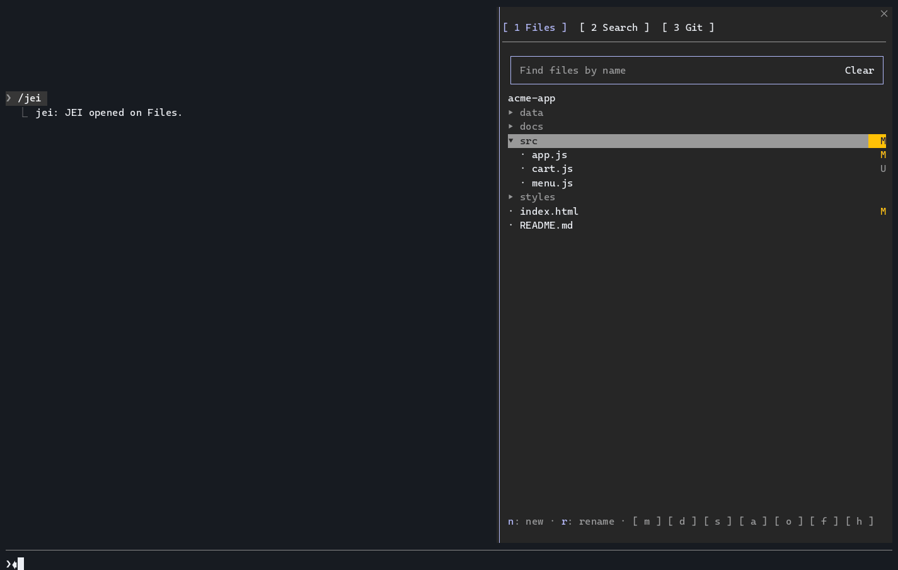
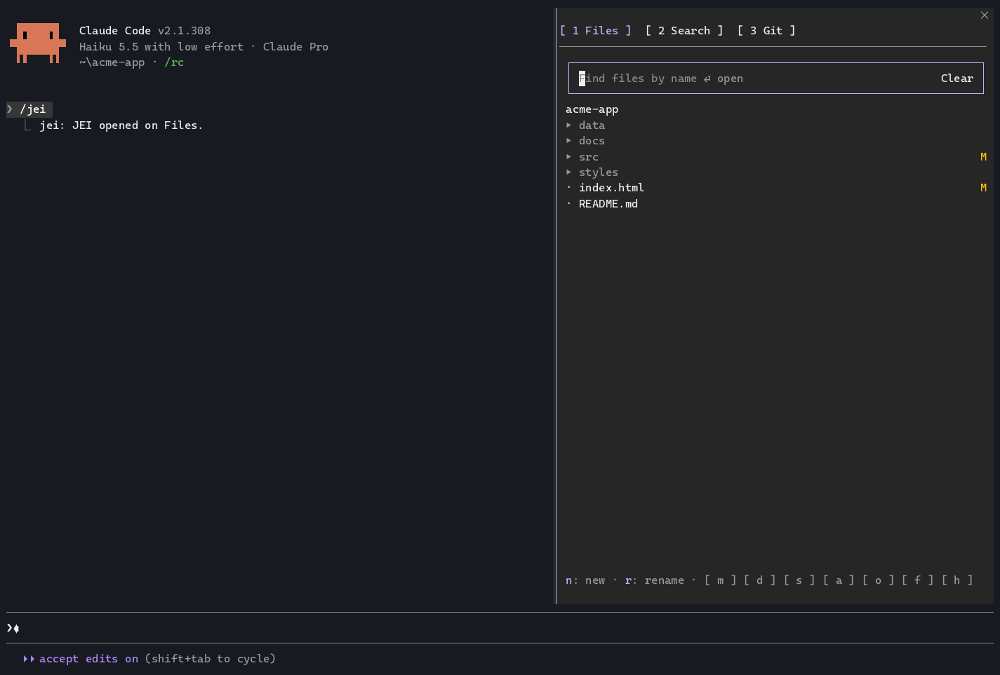
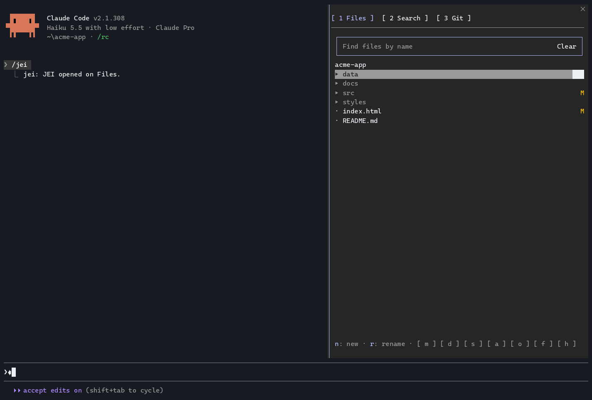
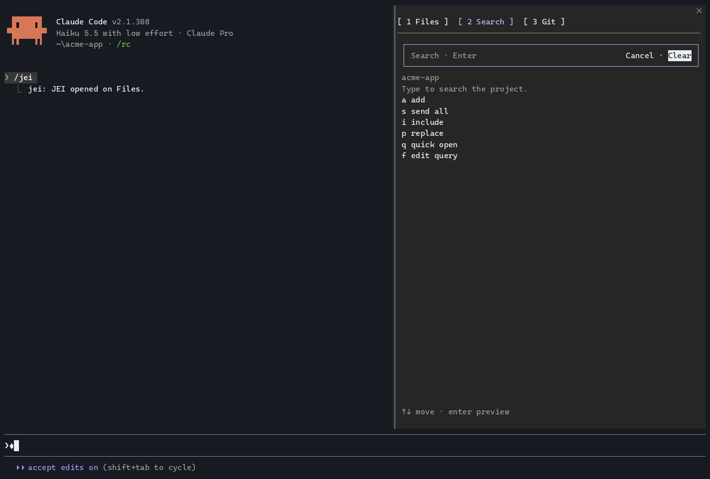
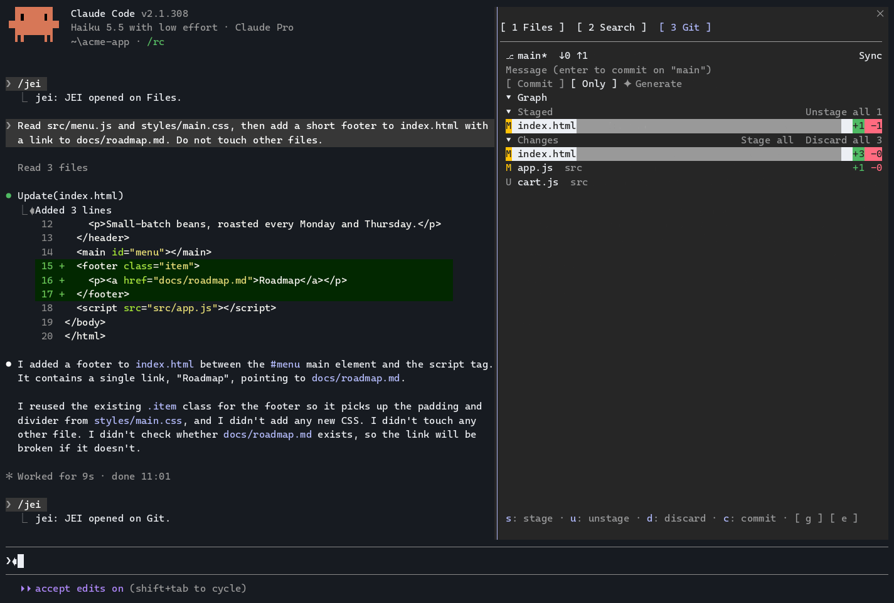
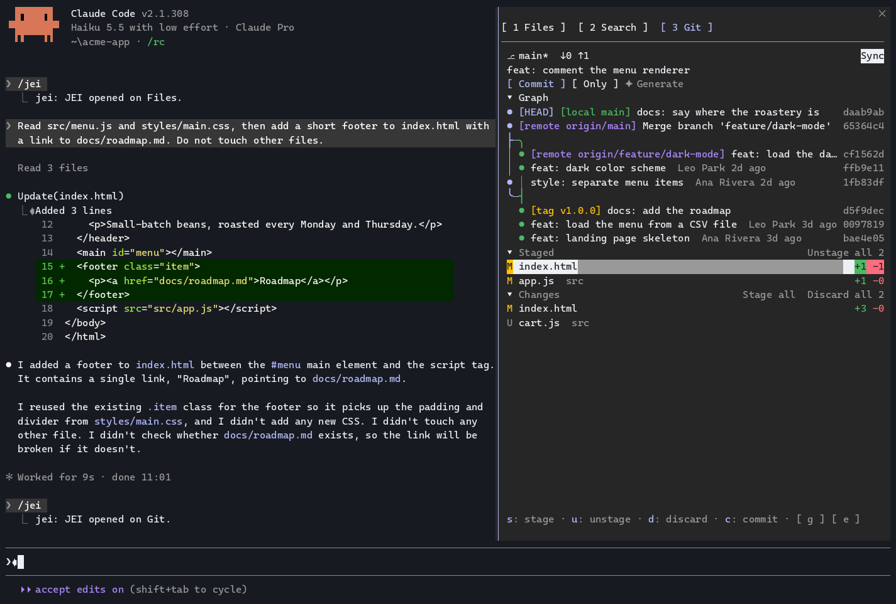
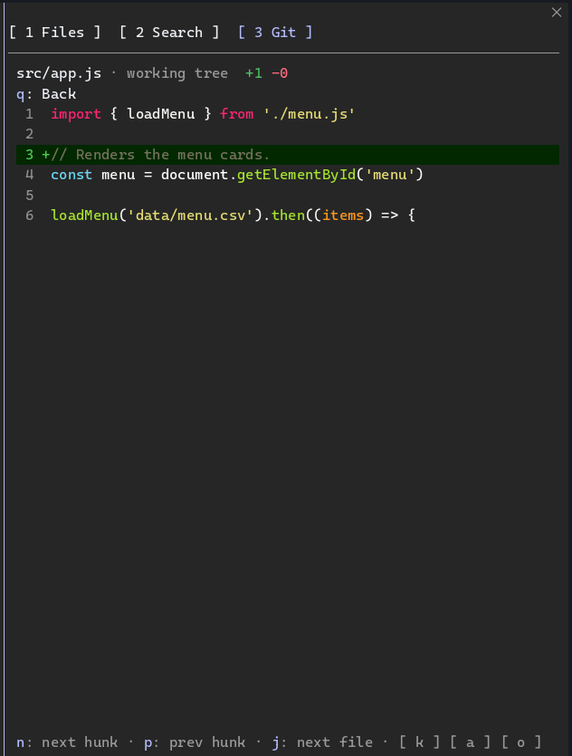

# JEI — Just Enough IDE

<!-- logo: added by the maintainer before the public release -->

> The parts of an IDE you still need when the AI writes the code: a file tree, project search and a full Git panel, docked beside your Claude Code or OpenCode session.

JEI is a pane with three tabs (**Files**, **Search**, **Git**) that sits next to the agent's conversation. You watch what the agent reads and edits, search the project without spending tokens, review the changes and commit them, without leaving the session. Both hosts get the same features and the same keys from one codebase.

[](media/jei-agent.gif)

## Features

- **Files:** a lazy file tree with git status and a shimmer on the files the agent reads (purple), writes (orange) or touches through git (green). Follows the agent, finds filenames as you type, previews code, Markdown and CSV/TSV, mentions a file in the prompt, opens it in your editor, and creates, renames, moves and deletes files (delete always asks first).

  [](media/jei-files.gif)

  [](media/jei-file-ops.gif)

- **Search:** literal, case-insensitive search across the project with streamed results and include/exclude globs. Send one result or all of them to the agent, or replace with a reviewed, confirmed plan that changes only exact-case matches and refuses files that changed since the search. Quick Open finds files by fuzzy name, ranked by recent and agent-touched paths; append `:42` to jump to a line.

  [](media/jei-search.gif)

- **Git:** a repository row with branch and Sync, Staged and Changes with stage, unstage and confirmed discard, Commit, Commit & Push and Amend, and ✦ Generate for a commit message from your own model. Files that look like secrets (`.env`, private keys) need an explicit confirmation before they are committed.

  [](media/jei-git.gif)

- **Graph and Branches:** colored lanes and ref badges, inline commit files and diffs, copy hash, Ask, confirmed checkout and revert, links to GitHub/GitLab, markers on the commits your agent made, filters (`author:`, `path:`, `branch:`), create and switch branches, and compare with the main branch.

  [](media/jei-graph.gif)

- **Diff view:** a unified diff with hunk and file navigation, Ask about the change, and open in your editor.

  

## Install

### Claude Code

In a Claude Code session:

```
/plugin marketplace add maurild14/just-enough-ide
/plugin install jei@jei
```

Then run `/tui fullscreen` so the pane can dock beside the transcript, and `/jei` to toggle it. In the Claude Code desktop app, run the same commands in a session prompt; the pane works there by click too. Mods do not load in desktop WSL sessions, the VS Code chat panel or `claude -p`.

### OpenCode 2.x

Add the npm package to `opencode.json` (or `opencode.jsonc`); OpenCode installs it with Bun on the next start:

```json
{ "plugins": ["opencode-jei"] }
```

## Requirements

- Claude Code 2.1.302 or newer, in `/tui fullscreen` with at least 110 columns to dock; or OpenCode 2.0.32 or newer (1.x is not supported).
- `git` on your PATH.
- Recommended: `rg` ([ripgrep](https://github.com/BurntSushi/ripgrep)) for streamed Search. Without it, Search inside a repository falls back to `git grep` (tracked files, first match per line).
- Optional: a Nerd Font for file icons.

## Keys

`1`–`3` switch tabs. Every view lists its keys on its last line. `q` or the visible Back control goes back one level; OpenCode also accepts Esc (Claude Code reserves Esc for its prompt). Inside a text field, letters are text.

| View | Keys |
| --- | --- |
| Files | `s`/`f` find filenames, `enter` preview, `a` mention, `o` open in editor, `n` new (end with `/` for a folder), `r` rename, `m` move, `d` delete, `h` hidden files |
| Search | `f` edit query, `enter` preview, `a` send result, `s` send all, `i` globs, `p` replace, `q` Quick Open, `b` back to Files |
| Quick Open | `enter` preview, `a` mention, `q` back to Search |
| Replace | `enter` apply to file, `y` apply all, `a` Ask; every apply confirms |
| Git | `enter` expand/open, `s` stage, `u` unstage, `d` discard, `c` commit mode, `g` generate, `e` sync |
| Graph | `y` copy hash, `a` Ask, `b` branches, `f` filter, `t` fetch, `n` branch from commit |
| Branches | `enter` switch, `n` new branch, `c` compare, `f` filter |
| Diff | `n`/`p` hunk, `j`/`k` file, `a` Ask, `o` editor |

## Configuration

The same keys on both hosts. On Claude Code, set them in `/config`. On OpenCode, pass them as plugin options:

```json
{ "plugins": [{ "package": "opencode-jei", "options": { "defaultTab": "git" } }] }
```

| Key | Values | Default | Meaning |
| --- | --- | --- | --- |
| `startOpen` | on / off | on | Open the pane when a session starts (where it can dock) |
| `defaultTab` | `files`, `search`, `git` | `files` | Tab shown on open |
| `activity` | `reads and writes`, `writes`, `reads`, `none` | `reads and writes` | What the shimmer shows |
| `followAgent` | on / off | on | The tree follows the files the agent touches |
| `glyphs` | `auto`, `nerd`, `plain` | `auto` | Icon set |
| `editorCommand` | text | empty | Command that opens a file; `{path}` and `{line}` are replaced. Empty uses the system default |
| `commitModel` | text | empty | Model for ✦ Generate; empty uses the host default |
| `smartCommit` | on / off | on | Commit with nothing staged stages everything first |
| `graphLimit` | number | 200 | Commits loaded per page in the Graph |

## Privacy and security

- JEI is local. It sends nothing over the network itself and has no telemetry.
- The only model calls are the ones you start (✦ Generate and Ask), through your own host session and provider.
- `git fetch`, `pull` and `push` talk only to your own remotes, and only when you ask. JEI never fetches in the background.
- Every process runs as an argument list, never through a shell. File operations, previews and replacements stay inside the project root, and destructive actions always confirm.
- The npm package is published from GitHub Actions with npm trusted publishing and provenance; no npm token exists.

Details: [docs/security.md](docs/security.md). To report a vulnerability, see [SECURITY.md](SECURITY.md).

## Contributing

See [CONTRIBUTING.md](CONTRIBUTING.md). Product behavior lives in [PRD.md](PRD.md) and the engineering docs in [docs/](docs/README.md).

## License

[MIT](LICENSE)
